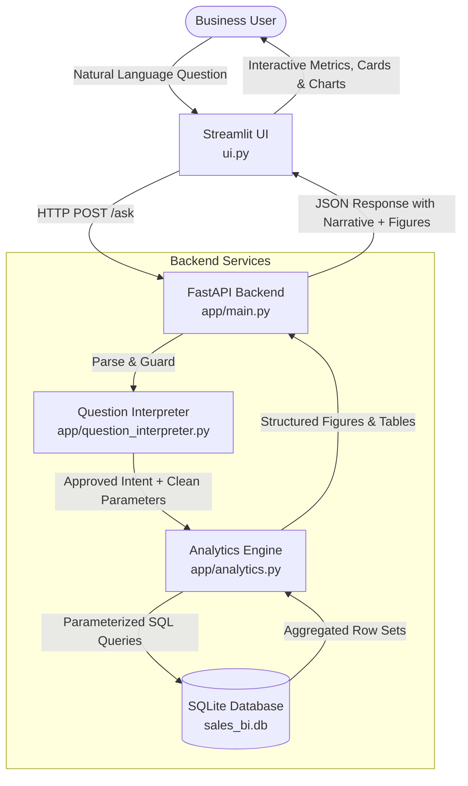
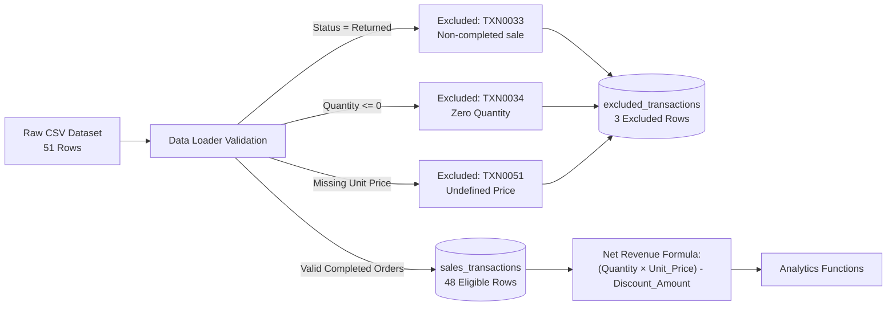
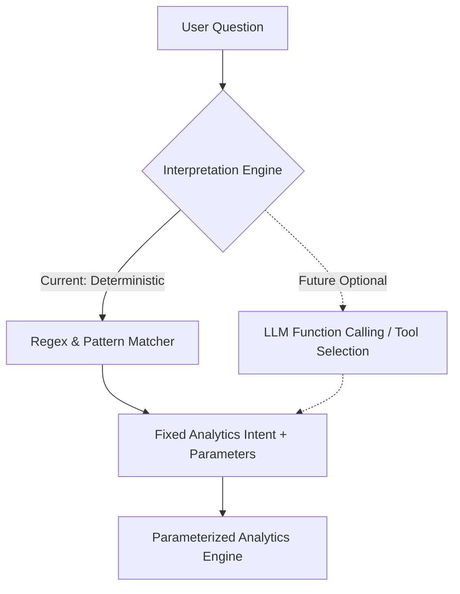

# Architecture & System Design

## 1. Architectural Overview

The **AI Business Intelligence Assistant** is structured as a decoupled, multi-tier analytics system. The architecture separates user interaction, API routing, natural language question interpretation, SQL analytical computation, and persistent relational data storage.

---

## 2. Component Breakdown

### 2.1 User Interface Layer (`ui.py`)
- **Technology**: Streamlit.
- **Role**: Presents an intuitive web interface for business users.
- **Responsibilities**:
  - Captures natural language inputs via a text query form or one-click example buttons.
  - Asynchronously communicates with the FastAPI backend over HTTP using `requests`.
  - Displays high-level KPI metric cards (Total Net Revenue, Completed Transactions, Excluded Records).
  - Renders interactive data visualizations (bar charts for product/regional breakdowns, line charts for monthly revenue progression).
  - Shows supporting tabular figures and highlights data governance notices.

### 2.2 API Service Layer (`app/main.py`)
- **Technology**: FastAPI, Uvicorn, Pydantic.
- **Role**: Stateless RESTful gateway providing validated endpoints.
- **Key Endpoints**:
  - `POST /ask`: Accepts JSON `{ "question": "..." }`, validates input, dispatches to the interpreter, invokes analytics, and returns structured narrative + metrics.
  - `GET /health`: Returns service health, database status, and record count.
  - `GET /examples`: Returns list of pre-configured, tested natural language queries.
  - `GET /summary`: Returns overall dataset metrics and data-quality exclusion logs.
- **Error Handling**: Global exception interceptor ensures raw Python stack traces are never exposed to clients.

### 2.3 Question Interpreter Layer (`app/question_interpreter.py`)
- **Technology**: Deterministic regex, linguistic pattern matching, date extractors.
- **Role**: Safely maps free-form natural language to approved analytics functions without relying on external, non-deterministic LLMs or paid API keys.
- **Security & Safety Guardrails**:
  - Arbitrary SQL commands, subqueries, and injection tokens (`DROP`, `SELECT * FROM`, `DELETE`, `;`, `--`) are intercepted and rejected immediately with HTTP 400 Bad Request.
  - Validates and normalizes period parameters (e.g., converts "January and February 2026" or "Jan vs Feb" into ISO parameters `{"month1": "2026-01", "month2": "2026-02"}`).
  - Unsupported or ambiguous questions trigger structured clarification messages rather than speculative guesses.

### 2.4 Analytics Calculation Engine (`app/analytics.py`)
- **Technology**: Parameterized SQL, Python `sqlite3`.
- **Role**: Executes verified mathematical computations against SQLite.
- **Design Rules**:
  - **No Hardcoded Answers**: All numbers, rankings, sums, and percentages are derived dynamically from database rows.
  - **Parameterized Queries**: All queries pass parameters via tuples `(?, ?)`, preventing SQL injection vulnerabilities.
  - **Standardized Currency & Formatting**: Formats currency amounts and calculates averages, ranks, and percentages.
  - **Edge-Case Resilience**: Explicitly handles zero denominators (division by zero), tied ranks, empty tables, and unrepresented months.

### 2.5 Relational Storage & Ingestion (`app/database.py`, `app/data_loader.py`)
- **Technology**: SQLite 3, Pandas.
- **Role**: Persistent local database and ETL data validation pipeline.
- **Database Schema**:
  - `sales_transactions`: Cleaned, eligible sales records with indexed columns (`order_date`, `product`, `region`).
  - `excluded_transactions`: Full audit log of records excluded by data quality checks.
  - `ingestion_metadata`: Ingestion timestamps, file sources, and record count tracking.
- **Idempotency**: Repeated imports cleanly refresh or upsert records, preventing duplicate entries.

---

## 3. Data Governance & Revenue Policy Flow

### Policy Rules Enforced:
1. **Completed Sales Requirement**: Non-completed or returned transactions are excluded from revenue.
2. **Strict Pricing Integrity**: Missing prices are never converted to zero. Doing so would artificially count units sold at zero price, skewing volume metrics.
3. **Quantity Integrity**: Zero or negative quantities are excluded.
4. **Unified Policy**: All five business questions compute figures against the identical filtered dataset.

---

## 4. Extensibility: Future LLM Integration

The decoupled design of `question_interpreter.py` enables seamless future integration of an LLM:

The LLM would only output a structured function call and parameters (e.g. `get_month_to_month_comparison(month1="2026-01", month2="2026-02")`), strictly preserving the parameterized SQL boundary and preventing arbitrary database execution.

